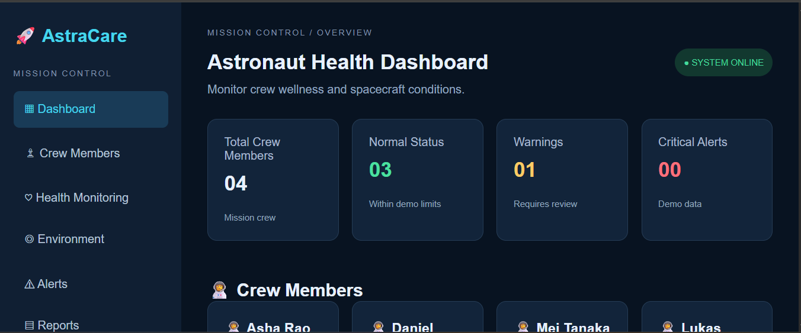

🚀 AstraCare – Astronaut Health Monitor

🌌 Project Overview

AstraCare is a web-based Astronaut Health Monitoring System designed to monitor astronaut wellness and spacecraft environmental conditions through a centralized dashboard.

The system provides an overview of crew members, health monitoring, environmental conditions, alerts, and reports.

✨ Features

- Dashboard: Overview of crew health and mission status.
- Crew Members: View astronaut information.
- Health Monitoring: Monitor crew wellness.
- Environment: View spacecraft environmental conditions.
- Alerts: Identify warnings and critical alerts.
- Reports: Access mission reports.

🛠️ Technologies Used

- Python
- Flask
- HTML5
- CSS3
- JavaScript

📸 Live Demo

"Click here to view AstraCare" (https://astronaut-health-monitor-7lam.onrender.com)

📂 Project Structure

astronaut-health-monitor/
│
├── static/
├── templates/
│   └── index.html
├── app.py
├── monitor_data.py
├── requirements.txt
└── README.md

⚙️ Installation and Setup

1. Clone the repository:

git clone https://github.com/harshitainingoji-is/astronaut-health-monitor.git

2. Open the project folder:

cd astronaut-health-monitor

3. Install dependencies:

pip install -r requirements.txt

4. Run the application:

python app.py

5. Open your browser and visit:

http://127.0.0.1:5000

🎯 Project Objective

To develop a centralized monitoring dashboard that helps visualize astronaut health information and spacecraft environmental conditions during space missions.

---

## 📸 Project Screenshots

### AstraCare Dashboard

---

## Project Presentation

[Click here to view the AstraCare PPT](./AstraCare_Presentation.pptx)

## 🌐 Live Demo

[Visit AstraCare](https://astronaut-health-monitor-7lam.onrender.com)

👩‍💻 Author

Project: AstraCare – Astronaut Health Monitor

